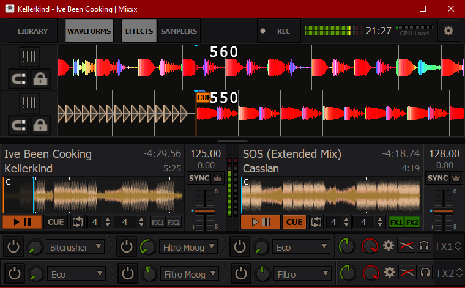

# LateNightMini-MX2-11

**LateNightMini-MX2-11** es una versión modificada (fork) de la excelente skin [LateNightMini](https://github.com/ghztomash/LateNightMini) creada por Tomash GHz. 

Esta versión está especialmente adaptada para su uso en **pantallas táctiles de 11 pulgadas** (probada en resolución 1280x720) utilizando una tablet Android como segunda pantalla en Windows 11, y optimizada para ser utilizada junto a un controlador externo (como el Traktor Kontrol MX2 o similares), delegando la mezcla física al controlador y dejando la pantalla para disparar cues, efectos y visualizar las ondas.

Requiere Mixxx 2.6 o superior.

## 🛠️ Modificaciones realizadas respecto al original

Esta versión incluye los siguientes cambios y mejoras de usabilidad:

- **Doble Rack de Efectos (FX1 + FX2):** Se ha añadido una segunda unidad de efectos completa apilada verticalmente debajo de la primera, permitiendo controlar dos efectos simultáneos sin salir de la vista principal.
- **Botón de Ajuste de Beatgrid:** Se reemplazó el botón de bucle (Beatloop) en el área de la waveform por un botón dedicado a ajustar la cuadrícula de tempo (icono de 3 barras con exclamación). 
  - *Clic izquierdo:* `beats_translate_curpos` (Alinea el golpe a la posición actual).
  - *Clic derecho:* `beats_translate_match_alignment` (Alinea con el otro deck).
- **Botones de Asignación FX Mejorados:** Se modificó el archivo `assign_buttons.xml` para que los botones de asignación de FX1 y FX2 en los decks tengan la misma apariencia, tamaño y peso visual, facilitando su uso táctil.
- **Interfaz táctil (Tema PaleMoon):** Optimizado para botones más grandes y accesibles, reduciendo la dependencia del mouse.

## 📸 Capturas de pantalla

## 📥 Instalación

Para instalar esta skin, clona este repositorio directamente en la carpeta de skins de tu Mixxx:

git clone https://github.com/gonzalo1980/LateNightMini-MX2-11.git ~/.mixxx/skins/LateNightMini-MX2-11

Ubicaciones comunes:

- **Linux:** `~/.mixxx/skins/`
- **Windows:** `%LOCALAPPDATA%\Mixxx\skins\`
- **macOS:** `~/Library/Containers/org.mixxx.mixxx/Data/Library/Application Support/Mixxx/skins/`

Abre Mixxx, ve a **Preferencias > Interfaz** y selecciona **LateNightMini-MX2-11**.

## 👥 Créditos y Licencia

- **Autor original:** Tomash GHz
- **Modificaciones (Fork):** Gonzalo (2026)
- **Basado en el trabajo de:** jus, Owen Williams, ronso0

Esta skin se distribuye bajo la licencia CC-BY-SA 4.0 (Creative Commons Attribution-ShareAlike), al igual que el proyecto original. Eres libre de compartir y adaptar el material, siempre que des crédito a los autores y distribuyas tus contribuciones bajo la misma licencia.

## 🔗 Referencias

- [Repositorio original LateNightMini](https://github.com/ghztomash/LateNightMini)
- [Mixxx DJ Software](https://mixxx.org/)

